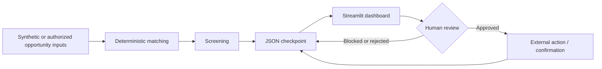

# Architecture and trust boundaries

## Data flow

## Boundaries

- Demo data is fictional; real application records and personal resumes are excluded.
- The prototype does not access external accounts or submit applications.
- Approval requires an identified human reviewer.
- A submitted stage requires a manually entered external confirmation reference; the code does not independently authenticate that reference.
- JSON checkpoints use atomic replacement and are suitable for single-user local operation, not multi-worker transactions.
- Skill-coverage scores are deterministic and are not AI-generated hiring probabilities.

## Roadmap

Independent adapters for permitted feeds, LLM-assisted reasoning, Google Sheets synchronization, richer observability, and transactional multi-user state.
